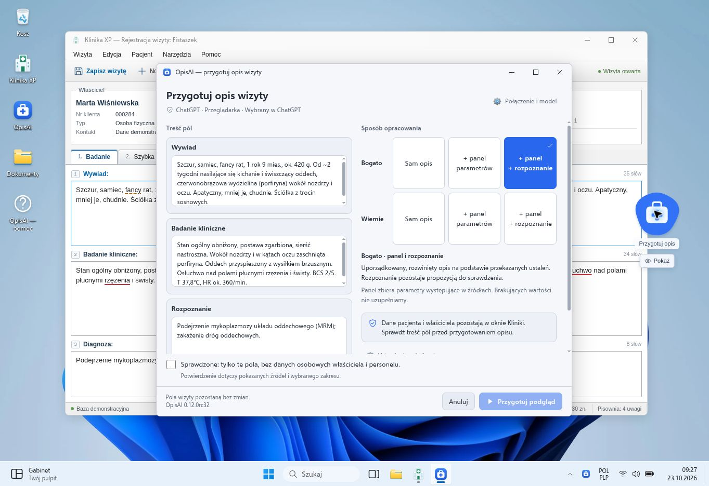

# OpisAI — interaktywna demonstracja

[Otwórz demo](https://guziczak.github.io/opisai/)

Demonstracja przeglądarkowa OpisAI, dostosowana do przebiegu pracy aplikacji **0.12.0rc32**. Interfejs gabinetu jest osadzony w pulpicie wzorowanym na Windows 11.



## Przebieg wizyty

1. Edytuj wywiad, badanie i rozpoznanie w Klinice XP.
2. Kliknij bąbelek OpisAI i sprawdź odczytane źródła.
3. Wybierz wariant Bogato lub Wiernie, zatwierdź materiał i rozpocznij opracowanie.
4. Przejrzyj wynik, porównaj go ze źródłem, popraw tekst i wybierz pola do wpisania.
5. Zatwierdź przegląd. Wpis zostanie wykonany wyłącznie wtedy, gdy stan pól zgadza się z odczytanym wcześniej.
6. Zapisz wizytę osobno w Klinice. Historię i cofanie wpisów znajdziesz w OpisAI.

Przytrzymanie bąbelka uruchamia przykładowe dyktowanie. Można zatrzymać, poprawić i kontynuować transkrypcję, przygotować z niej opis albo przejść do wpisania surowej notatki.

## Pulpit

- Ruchome okna z fokusem, ośmioma uchwytami zmiany rozmiaru, minimalizacją, maksymalizacją, przyciąganiem do krawędzi i menu systemowym.
- Pasek zadań z grupowaniem aplikacji, wskaźnikami i podglądami okien; menu Start, wyszukiwanie, widok zadań, kalendarz, powiadomienia i szybkie ustawienia.
- Eksplorator z kartami, lokalnym drzewem dokumentów, osobną historią nawigacji w każdej karcie, wyszukiwaniem, operacjami na plikach i Koszem.
- Notatnik z zapisem lokalnym, pobraniem pliku, wyszukiwaniem i ochroną niezapisanych zmian.
- Jasny i ciemny motyw, oryginalne tapety Bloom, wektorowe ikony oraz natywny Segoe UI z otwartym fontem Selawik jako zamiennikiem na innych systemach.
- Bąbelek z nazwą i wersją wewnątrz koła, sprężystym podążaniem za wskaźnikiem i krótkim wyhamowaniem po puszczeniu. Ruch pozostaje w obszarze pulpitu; trafienie w pole Kliniki wymaga jawnego upuszczenia na nim. Ograniczenie animacji w systemie lub ustawieniach OpisAI przełącza przeciąganie na bezpośrednie.

Wszystkie funkcje dotyczą pulpitu demonstracyjnego. Przeglądarka nie zmienia konfiguracji Windows, sieci ani urządzeń na komputerze odwiedzającego. Tryb pełnoekranowy jest dostępny w Ustawieniach; część skrótów klawiaturowych może przejąć system lub przeglądarka.

## Dane i granice demonstracji

Generowanie jest lokalnym formatowaniem przykładu, a dyktowanie odtwarza zapisaną transkrypcję. Demo nie łączy się z usługami AI, nie prosi o klucze API i nie włącza mikrofonu. Dowolny tekst wprowadzony przez użytkownika pozostaje źródłem wyniku; przykład Fistaszka nie zastępuje innej notatki.

Wizyta, dokumenty i ustawienia pulpitu są zapisywane w `localStorage`, pod kluczami zaczynającymi się od `opisai.demo.`. Ustawienia OpisAI są zapisywane pod kluczem `opisai-demo-settings-v12`. Historia operacji OpisAI pozostaje w bieżącej karcie i jest czyszczona po odświeżeniu strony. Ustawienia → Prywatność i zabezpieczenia → Przywróć ustawienia usuwa dane demonstracji, w tym oba zestawy ustawień. Do testowania należy używać fikcyjnych danych.

## Struktura

| Pliki | Odpowiedzialność |
| --- | --- |
| `index.html` | Dokument startowy i kolejność ładowania |
| `assets/shell.js`, `assets/windows.css` | Pulpit, okna, pasek zadań i wspólne kontrolki |
| `assets/desktop-apps.js` | Ustawienia, pomoc i terminal demonstracyjny |
| `assets/files-apps.js`, `assets/files-apps.css` | Eksplorator, lokalne dokumenty, Kosz i Notatnik |
| `assets/clinic.js`, `assets/clinic.css` | Wizyta i interfejs Kliniki |
| `assets/opisai.js`, `assets/opisai.css` | Bąbelek, przygotowanie, dyktowanie, przegląd i ustawienia OpisAI |
| `assets/orb-motion.js` | Niezależny od DOM model sprężyny, bezwładności i granic ruchu bąbelka |
| `assets/icons.js`, `assets/fonts/`, `assets/wallpaper-*.webp` | Zasoby wizualne |
| `assets/ASSET_SOURCES.md` | Źródła i licencje zasobów |

Projekt jest statyczny i nie wymaga kompilacji ani instalowania zależności. GitHub Pages publikuje pliki z gałęzi `main`. Do pracy lokalnej wystarczy serwer plików statycznych uruchomiony w katalogu repozytorium.

## Kontrola zmian

Kontrola składni: `node --check` dla zmienianych plików JavaScript. Testy bez dodatkowych zależności uruchomisz w Node.js 22 poleceniem:

```sh
node --test tests/*.test.cjs
```

GitHub Actions wykonuje te same kontrole dla push i pull requestów. Testy okien odtwarzają regresję ponownego otwierania po przeciągnięciu. Testy bąbelka sprawdzają model ruchu przy różnych częstotliwościach odświeżania oraz rzeczywistą obsługę kliknięcia, przytrzymania, upuszczenia, anulowania gestu i ograniczenia animacji. Harness DOM nie zastępuje oceny wyglądu w przeglądarce.

Najważniejsze ścieżki do sprawdzenia w przeglądarce:

- Przygotowanie → zmiana źródła unieważnia zatwierdzenie → opracowanie → edycja przeglądu → wpis → cofnięcie.
- Zmiana pola w Klinice w trakcie przeglądu → konflikt zatrzymuje wpis.
- Dyktowanie → zakończenie → kontynuacja / opracowanie / wpisanie notatki.
- Minimalizowanie i przywracanie, maksymalizacja, zmiana rozmiaru, przyciąganie i menu klawiaturowe.
- Zapis i ponowne otwarcie notatki, przeniesienie do Kosza i przywrócenie.
- Zmiana motywu oraz zachowanie okien na węższym ekranie.
- Przeciągnięcie Kliniki → puszczenie bez ponownego odtwarzania animacji otwarcia.
- Przeciągnięcie bąbelka → wyhamowanie bez otwarcia okna; upuszczenie na pole → przygotowanie wyłącznie tego pola; wyłączenie animacji → brak bezwładności.
